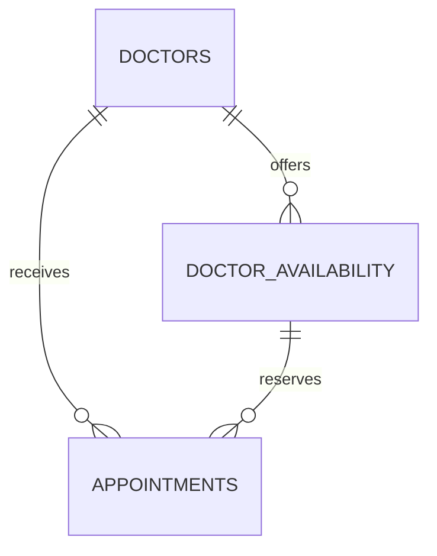

# Architecture and design decisions

## Layers

| Layer | Files | Key boundary |
| --- | --- | --- |
| Presentation | `app.py`, `.streamlit/config.toml` | Owns workflow and session state, delegates all bookings |
| Domain | `models.py`, `booking.py` | Validates values, computes bookable slots, commits reservations |
| Persistence | `database.py`, `data/clinic.sqlite3` | Enforces references, schedule integrity and confirmed-slot uniqueness |
| Demo configuration | `config.py`, `seed_data.py` | Defines hours, fictional doctors and rolling schedules |

Streamlit is the Python web frontend and server. A separate HTTP API is unnecessary for this local demonstration. The service and model modules do not import Streamlit, so they can be reused independently.

## Data relationships

An availability row is one 30-minute slot, not a whole daily shift. This makes the pair of schedule and booking constraints straightforward:

- `doctors.doctor_id`: primary key, with active status constrained to 0 or 1.
- `doctor_availability.availability_id`: primary key; `(doctor_id, appointment_date, start_time)` is unique.
- `appointments.appointment_id`: primary key; booking reference is independently unique.
- `appointments(doctor_id, appointment_date, appointment_time)` references the unique availability key.
- A partial unique index applies to `(doctor_id, appointment_date, appointment_time)` when status is `Confirmed`.
- Schedule insert/update triggers reject overlapping intervals for one doctor/date.
- Date/time format checks reject malformed or reversed schedule intervals.
- Date indexes support calendar range queries. The active-booking unique index supports occupied-slot exclusion.

There can be historical cancelled bookings for a slot, but at most one confirmed booking. There is no cancellation interface in this project. Direct database writes still obey foreign keys and uniqueness; user-friendly validation, future-time checks, purpose validation, and active-doctor checks belong to the service boundary.

## Atomic booking

1. Parse the requested date/time and visit purpose.
2. Open a new connection with foreign keys, a five-second busy timeout, and the database's WAL journal mode.
3. Execute `BEGIN IMMEDIATE` before any availability check. SQLite allows one writer at a time.
4. Read the current clinic clock **after** acquiring the lock; validate the patient again.
5. Check whether the same reference already committed an identical request. If so, return the same confirmation.
6. Reject an elapsed time, inactive/missing doctor, nonexistent slot, or already-confirmed slot.
7. Insert the appointment using parameters, obtain the confirmation, and commit.
8. Close the connection. Any exception rolls back an unfinished transaction.

Two independent sessions attempting the same slot serialize at the write lock. The second sees the first committed booking and gets `SlotUnavailable`. Even code that bypasses this check cannot create two confirmed rows for that slot because of the unique index. Lock exhaustion raises `BookingBusy`, which allows a safe retry.

A reference is `WC-` plus 24 cryptographically random uppercase hexadecimal characters. Each review has its own reference. A repeated confirm for the same request returns the original result; reuse of that reference for changed details is rejected. The UI never automatically switches to a different doctor after a conflict.

## Time and availability

Dates and slot times are stored as clinic-local ISO dates and `HH:MM` values. Comparison uses timezone-aware datetimes in `America/Los_Angeles`; creation timestamps are UTC. The demo schedules are daytime hours, avoiding ambiguous overnight DST transition times.

`get_available_slots` joins active doctors to schedule rows, excludes confirmed appointments, then removes slots at or before the current clinic time. “Any Available Doctor” omits the doctor filter and retains the doctor identity on every returned slot. Calendar events contain only date-level availability counts, never patient information.

The rolling seed runs once per database path/date in each server process and is idempotent across processes. It extends schedules without changing doctors or deleting existing schedules/bookings. Changing configuration requires a fresh demo database, as documented in the README.

## UI state

Five screens collect patient details, visit purpose, doctor selection, date/time selection, and a final review. Successful confirmation is a separate screen. Button callbacks update the step before the next render. Validated domain values are separate from temporary widget keys, so returning to earlier screens preserves saved details.

Changing doctor/date clears the chosen slot and reference. Calendar component clicks are processed once per callback payload, and changing the alternate date picker resets that callback state. Refresh invalidates the component and reloads availability. The booking service still rechecks availability on confirmation.

The confirmation data class deliberately omits DOB. User-provided text is escaped when inserted into styled HTML. Queries use SQLite placeholders, and error logs do not contain input values. These are sensible demo boundaries, not a claim of production security or healthcare compliance.

## Deliberate tradeoffs

- Month calendar plus native time/doctor selector, rather than hundreds of overlapping time events. A date field provides an alternate keyboard-friendly path if the iframe fails to load.
- Local SQLite rather than a distributed database. Suitable for a small demonstration, not multiple web-server replicas sharing a network file.
- No slot holds, background refresh, notifications, or account management.
- A small CSS layer gives a clinic-style design while retaining labeled Streamlit controls.
- Browser screenshots and responsive rendering remain unverified in the build environment. See `MANUAL_QA.md`.
